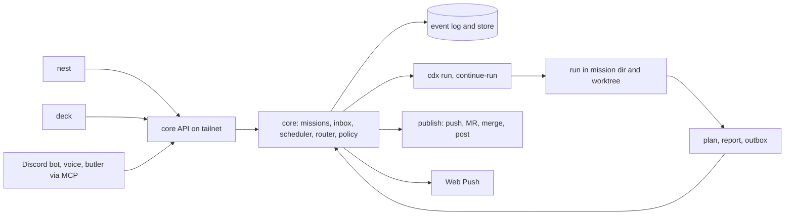

## adr_001_core_missions_and_inbox_architecture - Core missions and inbox architecture
> Date: 2026-11-06
> Status: Proposed
> Related request: `req_028_jarvis_layer_missions_inbox_butler_chat_model_router`, `req_037_mission_kinds_and_run_contract`, `req_039_news_board_for_tech_news_and_repos`
> Related backlog: (none yet)
> Related task: (none yet)
> Drivers: hands-off work from nest and deck; park and resume without held sessions; one API for every surface; hard rules in one place; cheap to run on the laptop first.
> Reminder: Update status, linked refs, decision rationale, consequences, and follow-up work when you edit this doc.
> Indicators reviewed: 2026-11-07 11:21:48

# Flow

# Overview
core is one always-on service. It owns missions, the inbox, the scheduler, the router and policy. Runs talk to it through files in a mission dir. Every surface reads one HTTP API. core alone publishes.

# Context
- Today crow dispatches cdx runs and tracks them with `crow runs`; questions come back in terminal sessions.
- Ultron and Jarvis converge on the same shape: a mission store, an engine that drives agents, a file or block contract for questions, a web front end over one API.
- Ultron runs on one Mac: Node server, `node:sqlite`, launchd tick every 5 min, marker files per phase. Its lessons: schema first, one event log from day one, budget context early.
- Jarvis runs on three hosts: Python stdlib server, JSON mission records, systemd timers, engine pushes and merges. Its lessons: core before UI, data contract before screens, cache from day one (mission views grew to 5 to 8 s).
- cdx already gives `run --detach`, `--continue-run`, `--failover`, `select` and `conversation`. core builds on those and does not reimplement agent control.
- Owner decisions 2026-11-07 settled the spikes: Go core plus Python sidecars (req_031), laptop and tower as mission hosts (req_029), long-lived `claude -p` butler engine (req_032), sandbox choices (req_030). This decision holds with them.

# Decision
## One process
- core is a systemd user service on the control host (laptop first). It owns the mission store, inbox, scheduler, router, policy, summaries and event log. Surfaces hold no logic.
- A tick (every 2 min) finishes runs, admits queued missions, updates summaries, runs watchdogs and a reconciler (store vs mission dirs, cdx runs and forge state; a mismatch becomes an incident). Timers start scheduled jobs. No model is called by the tick.
- Paths (store, mission dirs, worktrees) come from config so core can move to a homelab later.
- Kinds are data files (one per kind: gates, autonomy, scopes, account, effort, caps, skill). core reads them; adding a kind needs no code change.
- A "pause all publishing" switch in config and on the System screen stops every publish action at once; missions keep running up to their gate.

## Mission record
| Field | Meaning |
| --- | --- |
| `id` | Stable slug, `YYYYMMDD-kind-short` |
| `kind` | One of the 8 req_037 kinds (data file) |
| `batch` | AFK batch id when the mission is part of one, else null |
| `scope` | work or personal |
| `data_class` | work, personal, private |
| `project` | Registry name from `local/projects.yaml` |
| `goal`, `end_state` | Owner words |
| `autonomy` | ask, notify, auto |
| `gates` | From the kind, overridable per mission |
| `state` | See below |
| `runs` | List of cdx run ids with account, start, end, exit cause |
| `version` | Current plan or report version |
| `validation` | Event id of the last valid `ok`, or null |
| `file_scope` | Globs the run may touch, for overlap checks |
| `budget` | Time cap, token cap, resume cap |
| `branch`, `worktree`, `mr` | When code is involved |

**States:** `preflight → queued → running → waiting → review → publishing → done | failed | cancelled`. `waiting` and `review` hold no session; the mission is parked.

## Files as protocol
Mission dir `missions/<id>/`:
- `brief.md`: written by core (goal, owner prefs, answers so far, constraints, reply contract).
- `plan.vN.md`, `report.vN.md`: written by the run, each with one fenced `crow` block (schema in req_037).
- `outbox/`: `questions.json` and artifacts (HTML, images, video, diffs). Size caps enforced on ingest.
- `answers.vN.md`: the owner's words, kept per version.
A run that needs the owner writes and ends its turn. core parses the block, creates the inbox item, parks the mission.

## Resume
The answer is appended to the brief. core calls `cdx run --continue-run <run>`. A usage limit ends the run the same way; core resumes on the next allowed account after a quota probe. After N resumes in a row without a gate (`budget.resumes`), core parks the mission (`queued → waiting`) on a `resume-cap` question; `continue` allows one more resume, `stop` cancels. A run cut by a usage limit resumes cold from the brief. Review and continued runs keep their account constraints.

## Event log
- Append-only JSONL is the source of truth: `{ts, mission, type, actor, data}`. Types include `created`, `state`, `run_start`, `run_end`, `question`, `answer`, `validation`, `publish`, `incident`, `manual_gesture`, `push_sent`.
- The store (SQLite proposed) is rebuilt from events: missions, inbox, stats, and an FTS index over typed messages and replies (tool output excluded).
- Artifacts stay on disk. Files-only stays the fallback if req_031 prefers it.

## API
- Bound to localhost and the tailnet only. Tailnet identity header checked against the owner; every POST needs a custom header (CSRF).
- Read endpoints first: `/state` split in sections (inbox, missions, runs, accounts, machines, jobs), each with `updated_at` and an ETag; mission detail; artifacts; event feed. Responses cached on store version.
- Actions second: dispatch, answer (verb + text + attachments), stop, cancel, hide, publish preview, publish confirm.
- Live updates: SSE or polling with ETags (req_031). Web Push sent by core with VAPID keys kept on disk; ntfy only as a fallback.
- MCP server over the same API for the butler, interactive sessions and the Discord bot. Same auth and policy; read tools and `tell`/dispatch only, never `ok`, `go` or mockup approval.

## Publish
- Push, MR, merge, Jira and Confluence writes, mail and posts are core actions behind policy. Agents hold no work credentials.
- Work: publish needs a valid validation record for the exact text shown to the owner.
- Personal: merge on green CI, a secret scan over the commit range and a diff size limit; sensitive paths (CI, sandbox, units, policy) always ask.

## Housekeeping
- Disk floor checked before a worktree; merged worktrees pruned (squash included), never with uncommitted changes or stacked branches.
- crow deploy: merging main updates the installed copy and restarts core if its code changed.
- Backup of store, config and mission dirs daily; alert past 36 h.

# Alternatives considered
- **Agent keeps the session open and waits** (classic interactive loop): holds a slot and quota for hours. Rejected.
- **Front end owns state** (each surface polls cdx): logic duplicated across deck, nest and bots. Rejected.
- **JSON records only, no event log** (Jarvis): simple, but stats and incident passes need history. Ultron regretted not starting with events.
- **Agent publishes with scoped tokens**: fewer moving parts, but hard rules would live in every prompt. Rejected for work; open for personal in req_030.

# Consequences
- deck, nest, bots and the butler are thin clients; a new surface costs no engine work.
- Park and resume holds no tokens; a mission can wait days, and the laptop can sleep.
- Dispatch prompts and skills must follow the req_037 contract.
- core is a single point of failure: deck keeps a read-only fallback over the store, and a watchdog restarts core.
- The event log grows: rotate monthly, keep the store rebuildable.

# Follow-up work
- Groom req_028 slices 1 to 3 against this decision, with req_037 first.
- Today's `crow dispatch` records (item_074) are written as core-shaped events, so the store can import them on day one.
- AFK batches (req_028 slice 10) and the news scout (req_039) run as core jobs.
- Backend language is decided (Go core, req_031). Confirm the store on the Go side, the publish path with req_030, hosts with req_029.

# References
- Related request: `req_028_jarvis_layer_missions_inbox_butler_chat_model_router`
- Run contract: `req_037_mission_kinds_and_run_contract`
- Product brief: `prod_005_crow_jarvis_layer`
