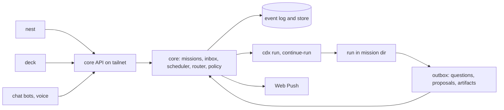

## adr_001_core_missions_and_inbox_architecture - Core missions and inbox architecture
> Date: 2026-11-06
> Status: Proposed
> Related request: `req_028_jarvis_layer_missions_inbox_butler_chat_model_router`
> Related backlog: (none yet)
> Related task: (none yet)
> Drivers: hands-off work from nest and deck; park and resume without held sessions; one API for every surface; cheap to run on the laptop first.
> Reminder: Update status, linked refs, decision rationale, consequences, and follow-up work when you edit this doc.

# Flow

# Overview
- core is one always-on service that owns missions, the inbox and events; runs talk to it through files; every surface reads one HTTP API.

# Context
- Today crow dispatches cdx runs and tracks them with `crow runs`; questions come back in terminal sessions.
- Both colleague systems converge on the same shape: a mission store, an engine that drives agents, a file or block contract for questions, and a web front end over an API.
- cdx already gives `run --detach`, `--continue-run`, `--failover`, `select` and `conversation`. core builds on those and does not reimplement agent control.
- Hosts, safety model, backend language and butler engine are open spikes (req_029 to req_032). This decision must hold whatever they pick.

# Decision
- **One process, core.** A systemd user service on the control host (laptop first). It owns: mission store, inbox, scheduler, router, policy, summaries, event log. No surface owns logic.
- **Mission is the unit.** A mission has goal, kind, scope, data class, budget, end state, autonomy level, gates. It maps to one or more cdx runs. States: `preflight → queued → running → waiting → review → done | failed | cancelled`.
- **Files as protocol between runs and core.** Each run gets a mission dir with `brief.md` (input), `outbox/` (questions and proposals as small JSON or a fenced block, plus artifacts: HTML pages, screenshots, diffs) and `report.md` (output). A run that needs a decision writes to `outbox/` and exits. core turns it into an inbox item and parks the mission.
- **Resume through cdx.** The answer is appended to the brief and core calls `cdx run --continue-run <run>`. Usage limits end the run the same way and resume on the next allowed account.
- **Event log is the source of truth.** Every transition and inbox item is an append-only event. Summaries, stats, digests and the incidents pass read events. Proposed store: SQLite (events, missions, inbox, FTS index for transcripts) with artifacts on disk. Files-only stays the fallback if the backend spike prefers it.
- **HTTP API on the tailnet only.** Read endpoints first (missions, inbox, runs, summaries, sections with ETags), actions second (dispatch, answer, cancel). Server-sent events or polling with ETags for live updates. Web Push is sent by core.
- **Engine holds the keys.** Push, PR, merge and outbound messages are core actions behind policy, never agent actions, so hard rules live in one place (exact sandboxing per req_030).
- **Scripts before models.** Scheduled jobs are scripts that write events; a model only narrates events into short text.

# Consequences
- deck, nest, Discord or Telegram and the butler are all thin clients; adding a surface costs no engine work.
- Park and resume holds no tokens while the owner is away; a mission can wait days.
- The run prompt contract (`brief.md`, `outbox/`, `report.md`) must be added to dispatch prompts and to each mission kind.
- core becomes a single point of failure: a deck fallback reading the store directly, and a watchdog, are needed.
- Moving core to a homelab later means moving the store and the mission dirs; keep paths configurable from day one.

# Follow-up work
- Groom req_028 slices 1 to 3 against this decision.
- Confirm the store choice and the backend language with req_031.
- Confirm the publish path with req_030.

# References
- Related request: `req_028_jarvis_layer_missions_inbox_butler_chat_model_router`
- Product brief: `prod_005_crow_jarvis_layer`
- Related backlog: (none yet)
- Related task: (none yet)
