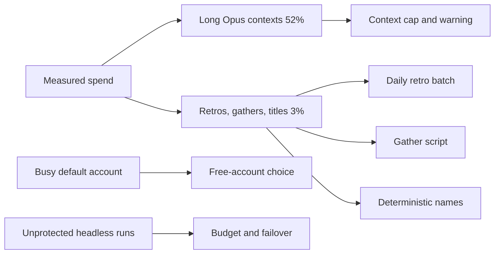

## prod_003_crow_cost_and_reliability_pass - crow cost and reliability pass
> Date: 2026-10-29
> Status: Proposed
> Related request: `req_008_crow_cost_and_reliability_pass_batched_retros_script_gathers_session_names_account_choice`
> Related backlog: `item_023_context_cap_and_long_session_warning`, `item_024_daily_retro_batch_with_a_no_model_pre_filter`, `item_025_gather_script_for_brief_daily_and_weekly`, `item_026_deterministic_session_names`, `item_027_free_account_choice_for_crow_open_term_and_handoff`, `item_028_budget_failover_and_kind_on_headless_runs`, `item_029_trim_hub_start_context_and_fix_per_model_usage`
> Related task: `task_003_deliver_the_crow_cost_and_reliability_pass`
> Related architecture: (none yet)
> Reminder: Update status, linked refs, scope, decisions, success signals, and open questions when you edit this doc.
> Indicators reviewed: 2026-10-29 17:12:33

# Overview
Cut the hub's token spend where it is measured to go (long Opus contexts, per-session retros, gather turns) and make the automatic parts deterministic.

# Goals
- Lower 14-day spend by 10-15% at the same amount of work.
- No lost retros or runs on a usage limit.
- Same names and same drafts for the same input.

# Non-goals
- The HQ/deck UI redesign (req_007).
- Changes to cdx itself beyond wishlist entries.

# Overview diagram

# Scope and guardrails
- In: crow scripts, hub skills, cdx profile settings, runbooks.
- Out: cdx source code, project repos, the deck UI.

# Key product decisions
- crow keeps its own retro skill (it applies lessons) and reuses cdx run flags instead of cdx's built-in retro.
- Pre-filters, names and gathers are scripts; models only write prose and apply lessons.
- Accounts with a live session are never reused unasked.
- Owner decisions 2026-10-29: auto-compact at 150k with a warning at 120k and help splitting into scoped sessions; retro batch Monday to Friday evening, none on weekends; no default spend cap on headless runs (optional per run).

# Success signals
- 14-day spend re-measured with the audit method drops 10-15% at similar session counts.
- Zero retros or runs lost to a usage limit over two weeks.
- No "session already running" prompt from crow launches.

# References
- Product back-reference: `req_008_crow_cost_and_reliability_pass_batched_retros_script_gathers_session_names_account_choice`
- Task back-reference: `task_003_deliver_the_crow_cost_and_reliability_pass`
