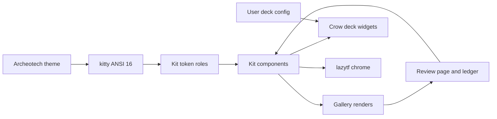

## prod_004_terminal_design_system - Terminal design system
> Date: 2026-11-03
> Status: Proposed
> Related request: `req_020_terminal_design_system_and_design_review_workflow`
> Related backlog: `item_078_design_review_workflow_crow_compare_v2_decisions_ledger_runbook`, `item_079_shared_terminal_kit_repo_tokens_and_gallery`, `item_080_kit_components_extracted_from_crow_deck_and_lazytf`, `item_081_customization_model_study_deck_config_vs_archeotech_shell_config`, `item_082_crow_deck_widget_contract_user_deck_config_tabs_rebuilt_from_widgets`, `item_083_lazytf_adopts_the_shared_kit`, `item_084_archeotech_themes_mapped_to_kit_token_roles`, `item_085_in_deck_design_decisions_widget`
> Related task: `task_010_orchestrate_terminal_design_system`
> Related architecture: (none yet)
> Reminder: Update status, linked refs, scope, decisions, success signals, and open questions when you edit this doc.

# Flow

# Overview
A shared, themeable component kit for Bubble Tea apps, a code-rendered design review loop, and a composable crow deck.

# Goals
- Review designs in one place with clear decisions and visible changes.
- Reuse components and tokens across crow deck and lazytf.
- Let users compose their own deck from widgets.
- Keep each design round cheap: edit fixtures, scripts render.

# Non-goals
- Porting archeotech QML widgets to Go.
- Painted themes or colours outside the terminal ANSI 16.
- Claude Design canvas or hand-edited artifacts for terminal UIs.

# Scope and guardrails
- In: scaffolded request, product, backlog, orchestration task, validation, and handoff context.
- Out: unrelated workflow docs and implementation of generated tasks.

# Key product decisions
- Use structured input as the source of truth for generated docs.
- Keep generated write paths local and repo-bounded.

# Success signals
- Generated docs pass lint and audit without broad manual rewrites.
- Context-pack output can be handed to an implementation agent directly.

# References
- Product back-reference: `req_020_terminal_design_system_and_design_review_workflow`
- Task back-reference: `task_010_orchestrate_terminal_design_system`
