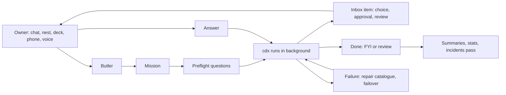

## prod_005_crow_jarvis_layer - Crow Jarvis layer
> Date: 2026-11-06
> Status: Proposed
> Related request: `req_028_jarvis_layer_missions_inbox_butler_chat_model_router`, `req_029_spike_hosts_model_sources_and_local_ai_benchmarks`, `req_030_spike_mission_safety_and_sandbox`, `req_031_spike_nest_stack_and_app_shape`, `req_032_spike_butler_engine_and_persona`, `req_033_spike_android_extras_for_nest`, `req_034_work_views_in_nest`, `req_035_forge_ops_in_nest`, `req_036_fun_layer_for_crow`, `req_026_personal_butler`
> Related backlog: (none yet)
> Related task: (none yet)
> Related architecture: `adr_001_core_missions_and_inbox_architecture`
> Reminder: Update status, linked refs, scope, decisions, success signals, and open questions when you edit this doc.

# Flow

# Overview
crow becomes a hands-off assistant. The owner states a goal, a mission runs it in the background through cdx, and the owner only sees questions, approvals, proposals and short human status. One butler, one inbox, one core API, shown in nest (web and phone), deck (terminal) and push notifications. Detail stays one tap away (MR pane, live terminal, full trail).

Ideas come from two colleague systems and the owner's own wishes:
- **Ultron (colleague):** two gates (plan, go, report, publish), files as protocol, guard hook, park on usage limit and resume on another account, butler chat with transcript search, incidents turned into roadmap proposals, ambient screensaver.
- **Jarvis (colleague):** mission store and kinds, preflight questions, sandboxed agents where the engine pushes, green CI auto-merge, self-repair catalogue, mockup loop, PWA with Web Push, digests and quiet hours, groups nav, no-LLM scheduled jobs, narration that only rephrases facts, machines page.

# Goals
- The owner steers work and personal projects from nest or deck, not from terminal sessions.
- Most flows run without the owner; the ones that need the owner stop at one clear question.
- Status reads as short sentences; raw trails stay available, never pushed.
- Every model source is used for what it is good at, with no work data leaving Claude accounts.
- It is fun to use and to tinker with.

# Non-goals
- Replacing project sessions for deep repo work: missions call them, they do not absorb them.
- Relaxing work hard rules: work push, MR, merge, mail and Teams always go through an approval item with the exact text.
- Home automation now (later, once the hardware exists).
- A public product. Engine code stays generic so it can be published later.

# Key product decisions (owner, 2026-11-06)
- **Surfaces:** one core API; nest and deck are thin views of it. nest home is a dashboard with inbox and today; the butler chat is reachable from every screen.
- **Gates per mission kind:** some kinds run plan → go → work → report → publish, others run straight through.
- **Questions:** preflight questions before dispatch; a question mid-run parks the mission (the run exits) and the answer resumes it with `--continue-run`.
- **Hosts:** laptop first. Homelab as control later, if the hosts spike says it is worth it. Tower only as an idle worker, never taking performance while the owner plays.
- **Safety:** decided after a research spike comparing guard hooks, sandboxing and engine-publishes (req_030).
- **Stack:** React front end (the work team's stack), Go or Python backend; app shape (PWA, web app, phone app) decided by req_031.
- **Notifications:** Web Push. Asks push at once with action buttons; FYIs and finished missions go out in a digest every few minutes; quiet hours 22:00 to 08:00 except prod incidents; work items silent outside work hours, personal items silent in work focus.
- **Butler:** one scope-aware butler with a focus mode (work only, personal only). Full character persona. Reachable from nest, a deck pane, voice, Discord or Telegram, and the Android assistant. Engine chosen by req_032.
- **Views:** dashboard home, mission detail, mockup loop, live terminal, groups nav.
- **Personal repos:** a code mission auto-merges on green CI plus a secret scan; a diff above a size limit falls back to asking. Work repos keep the hard rules.
- **Scheduled jobs:** scripts first. A model only narrates at the end and only rephrases the facts it was given.
- **Failures:** repair catalogue (at most 2 rounds, then ask), account failover on usage limit with quota probe before dispatch, silent-run watchdog at 30 min, incident log with a weekly pass into roadmap proposals.
- **Models:** Claude accounts for anything that matters and all work data. Google free usage through Antigravity in cdx, on the owner's Gmail accounts, for side-project overflow and cheap tasks; the terms risk of several accounts is checked first (req_029). Local Ollama for private data and summaries, after benchmarks on the laptop, tower and homelab.

# Feature map
Source: U = Ultron, J = Jarvis, O = owner. Home is the request that carries it.

| Area | Feature | Source | Home |
| --- | --- | --- | --- |
| Core | Mission model, kinds, states, budgets | J, U | req_028 |
| Core | Inbox: choice, approval, review, FYI; park and resume | U, J, O | req_028 |
| Core | Autonomy dial per kind; gates per kind | U, J, O | req_028 |
| Core | Human summaries from `cdx conversation` | O | req_028 |
| Core | Model router, quota probe, failover | U, J, O | req_028, req_029 |
| Core | Repair catalogue, watchdog, incident log | J, U | req_028, req_035 |
| Butler | Scope-aware butler, focus mode, persona | O, J | req_032 |
| Butler | Transcript search across all sessions | U | req_032 |
| Butler | Voice, Discord or Telegram, Android assistant | J, O | req_032, req_033 |
| nest | Dashboard home, groups nav, chat everywhere | J, O | req_031 |
| nest | Mission detail, mockup loop (approve, change up to 5, abandon) | J | req_031 |
| nest | Live terminal for a run | U | req_031 |
| nest | Web Push, digest, quiet hours, focus split | J, O | req_031 |
| Android | Widgets, Quick Settings tiles, Tasker, NFC, Wear OS, old phone as always-on display | O | req_033 |
| Work | Today page, sprint and team board, reports pipeline, incidents pass | U, J, O | req_034 |
| Forge | Machines and tools, nightly health, releases page, cost and quota | J, U, O | req_035 |
| Personal | Agenda and mail, bank and budget (local model), memos and notes | J, O | req_026 |
| Fun | Ambient screensaver, droid avatar and sounds, stats and achievements, drones view | U, O | req_036 |
| Later | Home automation | J | req_015 |

# Processes
- **Plan here, build later:** each request is groomed into backlog items in a fresh session; spikes finish before the slices that depend on them.
- **Mission lifecycle:** preflight → queued → running → waiting (parked) → review → done or failed. Each transition writes one event; summaries and stats read the events.
- **Learning loop:** repair catalogue entries, review ledger patterns and incident patterns feed the weekly pass, which proposes runbooks, autonomy upgrades or roadmap items.
- **Owner prefs:** `local/owner-prefs.md` goes into every mission prompt, as today for handoffs.

# Sequencing
1. Spikes first, in parallel with roadmap 0.3: hosts and models (req_029), safety (req_030), stack (req_031), butler engine (req_032).
2. Roadmap 0.3b: req_028 slices 1 to 5 on the laptop.
3. nest MVP and butler (req_028 slices 6 to 8, req_031, req_032).
4. Feature tracks in priority order: work views (req_034), forge ops (req_035), personal (req_026), Android extras (req_033), fun layer (req_036).

# Success signals
- A full work day passes with no terminal opened by the owner except for deep repo sessions.
- Most missions end with only an FYI; asks are answered from the phone in under a minute.
- Every live run reads as one sentence; nobody opens the raw trail to know what is going on.
- No work data reaches a non-Claude provider; no private personal data leaves the owner's machines.
- The owner shows nest to colleagues because it is nice to use.

# Open questions
- Where core runs long term (laptop, homelab) and where local models run: req_029.
- Guard hook, sandbox, or engine-publishes, or a mix: req_030.
- Go or Python backend; PWA, web app or phone app: req_031.
- Butler engine (long-lived `claude -p` stream, Agent SDK, gateway with tools): req_032.
- Mission store: SQLite in core or files: adr_001.

# References
- `logics/request/req_028_jarvis_layer_missions_inbox_butler_chat_model_router.md`
- `logics/architecture/adr_001_core_missions_and_inbox_architecture.md`
- `logics/roadmap/road_001_crow_roadmap_after_the_deck_pass.md`
- Colleague design docs (private copies): `local/reference/ultron-design.md`, `local/reference/jarvis-design-document.md`
