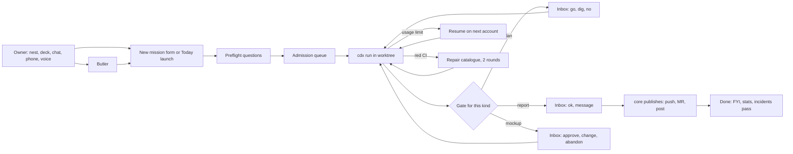

## prod_005_crow_jarvis_layer - Crow Jarvis layer
> Date: 2026-11-06
> Status: Proposed
> Related request: `req_028_jarvis_layer_missions_inbox_butler_chat_model_router`, `req_029_spike_hosts_model_sources_and_local_ai_benchmarks`, `req_030_spike_mission_safety_and_sandbox`, `req_031_spike_nest_stack_and_app_shape`, `req_032_spike_butler_engine_and_persona`, `req_033_spike_android_extras_for_nest`, `req_034_work_views_in_nest`, `req_035_forge_ops_in_nest`, `req_036_fun_layer_for_crow`, `req_037_mission_kinds_and_run_contract`, `req_038_nest_design_rules`, `req_026_personal_butler`, `req_039_news_board_for_tech_news_and_repos`
> Related backlog: `item_107_render_the_mission_brief_from_kind_record_and_answers`
> Related task: `task_016_orchestrate_jarvis_core_slices_1_and_2_missions_and_inbox`
> Related architecture: `adr_001_core_missions_and_inbox_architecture`
> Reminder: Update status, linked refs, scope, decisions, success signals, and open questions when you edit this doc.
> Indicators reviewed: 2026-11-10 11:18:57

# Flow

# Overview
crow today is a hub you drive from terminal sessions: skills, `crow dispatch` and `crow runs`, the deck TUI (MR pane, agents panel), review ledgers, Logics, cdx accounts. The Jarvis layer turns it into an assistant you steer from one interface. You state a goal; a mission runs it in the background through cdx; you only see questions, approvals, proposals and short status. Detail stays one tap away: the MR pane, the live terminal, the full trail.

This brief merges three inputs:
- **The owner's wishes**, collected in five question rounds on 2026-11-06.
- **Ultron**, a colleague's cockpit: Claude Code background sessions on one Mac around a two-gate workflow (plan, then report). About two weeks old, React PWA, iPhone. Private copy: `local/reference/ultron-design.md`.
- **Jarvis**, a colleague's operations assistant: missions that come back merged and deployed, a vanilla-JS PWA (HQ), a chat gateway, three hosts on a tailnet, nightly self-repair, home and personal pages. Private copy: `local/reference/jarvis-design-document.md`.

Both colleagues already use cdx and Logics, so most of their ideas port with little friction.

# The two reference systems
| Dimension | Ultron | Jarvis | crow target |
| --- | --- | --- | --- |
| Unit of work | Task: key + kind + instruction, one skill per kind | Mission JSON: kind, ask, project, attachments | Mission with kind, scope, data class, gates, autonomy (req_037) |
| Gates | Two gates: plan go, report ✓, then publish | Preflight only; mockup approve; auto-merge on green CI | Per kind: two-gate, mockup loop, or straight through |
| Questions mid-run | Session writes file, notifies, ends turn; resumed with answer | Not allowed: preflight, else `blocked` | Preflight first, then park and resume |
| Protocol | Markdown plan/report with fenced `ultron` block; marker files | JSON mission records | Markdown with a fenced `crow` block plus outbox JSON (adr_001) |
| Safety | ~170 allow rules, PreToolUse guard, Stop guard by phase, `validated/KEY` marker | bubblewrap, temp home, no git creds, pasta + nftables LAN block, engine pushes | Research (req_030); hard rules in core either way |
| Merge | Never | Auto on green CI + secret scan; sensitive paths manual | Personal repos auto; work repos never |
| Admission | 4 working, 3 waiting, ≥ 20 % free memory, quota | Oldest first, quota, worker ready, no overlapping file scopes, 1 h cap | Combine both (req_028 slice 1) |
| Accounts | 3 Claude, quota probe via Haiku headers, resume on another account | cdx profiles, `use`/`ask-first`/`never`, ≥ 20 % room, Codex first | cdx profiles + probe + per-scope routing (req_025, req_029) |
| Local models | Dropped, no measured need | Ollama (Gemma, Qwen) for private and bulk | For private data and summaries after benchmarks |
| Butler | Vision: long-lived `claude -p` stream-json, `brief`, chat search, `tell` | Hermes gateway, MCP tools, persona hooks, web + Discord | Research (req_032); scope-aware with focus mode, full persona |
| Front end | React 19 + Vite, xterm, OKLCH tokens, dark only | Vanilla ES modules, hash routes, tokens, dark/light, per-user accent | React (req_031), tokens shared with the terminal kit (req_038) |
| Server | Node `node:http`, ws, node-pty, `node:sqlite` | Python stdlib `ThreadingHTTPServer`, ETags, CSP | Go or Python (req_031) |
| Live updates | Polling 3 s, long-poll for chat, WebSocket terminal | Polling 30 s / 2.5 s during actions, ETags, 304 | To decide (req_031); ETags from day one |
| Push | Declarative Web Push, no service worker (iOS) | Web Push VAPID, 5 min digest, quiet hours, 12 h no-repeat | Web Push with full service worker (Android allows more); ntfy only as fallback |
| Hosts | One Mac | Main, worker, office hosts over Tailscale | Laptop first; homelab and tower later (req_029) |
| Scheduling | launchd tick every 5 min, no LLM | ~30 no-LLM jobs, systemd timers | systemd user timers, scripts first |
| Reports | Task report with verdict; recap; weekly; incidents; cost | Morning brief, digests, weekly narrated, Sunday local review | Existing skills fed by gather scripts, narrate-only (req_034) |
| Memory | Auto-memory, CLAUDE.md, FU registry, transcript index | One owner-prefs file for every agent, Logics, memos | owner-prefs, Logics, review ledgers, memos, transcript index |
| Fun | macOS screen saver | Ambient screen planned, home speakers | Screensaver, avatar, achievements, drones (req_036) |

# Goals
- The owner steers work and personal projects from nest or deck. Terminal sessions are kept for deep repo work.
- Most missions finish with only an FYI. The rest stop at one clear question with buttons.
- Every live run reads as one plain sentence. Raw trails are available but never pushed.
- Every model source is used for what it does best. Work data never leaves Claude accounts; private personal data never leaves the owner's machines.
- Every repeat costs less than the last: failures, manual gestures and corrections feed a weekly pass.
- It is fun to use and fun to tinker with.

# Non-goals
- Replacing project sessions. Missions call them; repo hooks and rules still run inside the repo.
- Relaxing work hard rules. Work push, MR creation, merge, mail and Teams always go through an approval item with the exact text.
- Home automation now. It returns once the hardware exists.
- Offline mode. Both colleagues dropped it: a stale screen must never look live.
- A product for others now. Engine code stays generic so it can be published later.

# Principles (lessons from both systems)
1. **End turns, never wait.** A run that needs the owner writes its question, notifies, and exits. Resume carries the answer. No slot or token is held while waiting. (Ultron)
2. **Files as protocol, schema first.** Plans, reports and questions are Markdown a human reads, with one small fenced `crow` block a machine parses. Define the schema before the first run. (Ultron lesson 2)
3. **One event log from day one.** Every transition, question, answer, failure and manual gesture is one JSONL event. Summaries, stats, digests and the incidents pass read it. (Ultron lesson 3)
4. **Validation is a file core checks, not a promise the model makes.** Publishing actions check an owner validation record. (Ultron)
5. **The engine publishes.** Agents never hold push, MR or messaging rights for work. (Jarvis)
6. **Scripts before models.** Scheduled jobs format facts with fixed wording. A model only narrates, only rephrases the facts it gets, and falls back to plain facts on failure. (Jarvis)
7. **Mockup before code** for any visual change. (Jarvis)
8. **One owner preferences file** read by every agent, mission and the butler. (Jarvis lesson 4; crow already has `local/owner-prefs.md`)
9. **Data contract before screens.** One state API, content keyed by screen, section timestamps, ETags and server-side caching from day one. (both)
10. **Design rules before the first screen.** Tokens, block order, phone checks. (Jarvis lesson 3)
11. **Every manual gesture is an incident.** It is logged so it can be automated later. (Ultron)
12. **Budget context and cost from the first run.** Compaction window, effort per kind, subagents on a smaller model. (Ultron lesson 4)
13. **Flaky tests are bugs.** A flaky gate stalls the queue and erodes trust. (Jarvis lesson 5)
14. **Scripts and hooks live in the repo** with config for anything private. (Ultron lesson 1; crow already splits engine and `local/`)

# Decisions (owner, 2026-11-06)
| Topic | Decision |
| --- | --- |
| Surfaces | One core API. nest is the main surface; deck gets an inbox pane and keeps the MR pane and agents panel. The 0.7 cockpit milestone folds into the Jarvis tracks. |
| nest home | Dashboard with inbox and today. The butler chat is reachable from every screen. |
| Phone | Galaxy Z Fold 6. nest handles the cover screen (narrow phone), the inner screen (near square, tablet width) and the fold and unfold switch without losing state (req_038). |
| Views wanted | Mission detail, mockup loop, live terminal, groups nav. |
| Gates | Per mission kind (two-gate, mockup loop, or straight through). |
| Questions | Preflight before dispatch; a mid-run question parks the mission and the answer resumes it with `--continue-run`. |
| Hosts | Laptop first. Homelab as control later, only if req_029 shows it pays. Tower only as an idle worker that never takes performance while the owner plays. |
| Safety | Decided by research (req_030), stealing from both. |
| Stack | React front end (the work team's stack, strong UI ecosystem). Go or Python backend. App shape (PWA, web app, phone app) by req_031. |
| Notifications | Web Push (proven by both colleagues). ntfy only if Web Push falls short. Asks push at once with action buttons. FYIs and finished missions go in a digest every few minutes. Quiet hours 22:00 to 08:00 except prod incidents. Work items silent outside work hours; personal items silent in work focus. |
| Android | Explore everything a tinkerer can do beyond iOS colleagues: widgets, tiles, Tasker, NFC, Wear OS, old phone display, assistant (req_033). |
| Butler | One scope-aware butler with a focus mode (work only, personal only). Full character persona. Engine by research (req_032). Surfaces: nest, deck pane, voice, a Discord bot (free-text chat, personal data only), Android assistant. Built after core; the req_026 butler items become core jobs. |
| Personal repos | Code missions auto-merge on green CI and a secret scan. |
| Work repos | Hard rules unchanged: never merge, push and MR only after the owner's OK on the exact text. |
| Scheduled jobs | Scripts first; narrate-only model step. |
| Failures | Repair catalogue (2 rounds then ask), account failover with a quota probe, silent-run watchdog, incident log with a weekly pass. |
| Models | Claude for anything that matters and all work data. Google free usage through the Antigravity provider in cdx on one Google account, terms checked first. Local Ollama for private data and summaries after benchmarks on laptop, tower and homelab. |
| Feature tracks | All work, forge, personal and fun features below. Home automation later. |
| Logics shape | This brief + an architecture doc + research requests + feature requests; grooming later in fresh sessions. |

# Mission model
Detailed in req_037; summary here.

**Kinds** (owner, 2026-11-06: 13 proposed kinds merged into 8; `admin` became butler jobs). Kinds are data files read by core, so adding one needs no engine change. Gates inside a kind are set by scope.
| Kind | What it does | Absorbs | Gates | Default autonomy | Account and model | Phase |
| --- | --- | --- | --- | --- | --- | --- |
| `research` | Read-only study, writes a report | | report only | full auto, FYI | Any allowed account; cheap model for gathering | 1 |
| `plan` | Turns a goal, a batch of memos or a news pick into Logics items | `notes` | plan go | ask | Personal or work Claude by scope | 1 |
| `review` | Review a colleague's MR with ledgers | | report ok before posting | notify | Work Claude | 1 |
| `design` | Mockup pages for a visual change | | mockup loop: approve, change (up to 5), abandon | ask | Claude; pages land in nest | 1 |
| `review-fix` | Address review threads on the owner's MR | | report ok before push | full auto up to local commit when every thread matches a ledger pattern | Work Claude | 2 |
| `write` | Doc, Confluence draft, or report (daily, weekly, management weekly, personal review); reports are started by a schedule | `document`, `report` | draft review, then core publishes | notify | Scripts + narrate-only model; Claude for docs | 2 |
| `build` | Code change end to end in a worktree | `ship`, `personal-code`, `crow` | work: plan go, report ok, core publishes. personal: none, auto-merge on green CI + secret scan. crow: plan go | ask (work), full auto (personal) | Work Claude high effort; personal account with Antigravity overflow | 3, after the sandbox |
| `repair` | Rebase a branch or fix a red pipeline from the catalogue | `rebase`, `ci-repair` | none until push; 2 rounds then ask | notify (work), auto (personal) | Claude, medium effort | 3 |

Each report carries proof of work in its `crow` block (tests run, commands, links). A reconciler in the core tick checks that state on disk, cdx and the forge matches the store.

**States:** `preflight → queued → running → waiting → review → publishing → done | failed | cancelled`, with `parked` as a waiting sub-state that holds no session.

**Admission:** start a queued mission only when an account has room (probe), the host has memory (≥ 20 % free), the counts are under caps (example 4 running, 3 waiting on the owner), no running mission touches the same file scope, and the target host is ready. Each run is capped (1 h default). Anything over waits with an ETA and a reason per account.

**Run contract:** each run gets a mission dir with `brief.md` (goal, answers so far, owner prefs), writes `plan.md` or `report.md` with a fenced `crow` block (summary, confidence, verdict, numbered questions with choices), drops artifacts in `outbox/` (HTML pages, screenshots, videos, diffs) and ends its turn. Each answered version is kept with the owner's words; the next version carries a "Responses" section saying what became of each point.

**Answer verbs:** `go` (start work), `dig` (more research on the plan), `no` (drop), `ok` (validate the report, unlocks publish), `msg` (comment without validating), `approve` / `change` / `abandon` (mockups), `pick` (choice item). A message after `ok` reopens the mission and drops the validation, so an old OK never lets a push through.

**Stop and cleanup:** `stop` signals the run, `cancel` removes a queued mission, `hide` takes it off lists. Worktrees are pruned once their branch merged (squash included), never with uncommitted changes or stacked branches. Earlier runs of a restarted mission are shelved in history.

# A day with crow
- **Morning, cover screen.** One push: the brief. Home shows asks first, then today and the Discover top three. Answers go in place with verbs.
- **Work hours, laptop.** nest beside the editor, deck inbox pane in the terminal. Missions start from Work (Today) or the New mission sheet. Design picks open on the inner screen or the desktop.
- **Away from the desk.** Asks arrive as pushes with buttons. An answer given while the laptop sleeps shows "queued, resumes when the laptop wakes".
- **Before leaving.** An AFK batch from the New mission sheet: preflight answered up front, go.
- **Next morning.** The batch digest in Missions, one card per mission.

**deck vs nest:** the deck answers and dispatches; nest does everything; the deck never shows artifacts heavier than a diff. The persona speaks in chat and personal surfaces; anything that becomes a work artifact uses a neutral voice.

**Retires once nest ships:** `crow-afk-page`, the night HTML pages, the Crow HQ research (2026-10-29), the terminal cockpit layout from req_022.

# Human in the loop
**Inbox item types:** choice (options with previews), approval (exact draft of push, MR, mail, post), review (report, diff, pages, mockups, proofs), FYI. A "who must act" view splits what waits on the owner from what waits on a machine or a person.

| Fully automatic | Always needs the owner |
| --- | --- |
| Admission, dispatch, account choice and resume after a usage limit | Starting a mission (never started by an alert alone) |
| Research, coding, local commits, self-review, tests | Go on a plan for kinds with a plan gate |
| Review drafts with ledger patterns | OK before any work push, MR, Jira or Confluence write, posted comment |
| Personal repo merge on green CI + secret scan, then deploy | Mockup approval |
| One repair per known failure cause, 2 rounds | Changes to CI, sandbox, systemd units, merge gate, policy |
| Nightly health, tool updates, backups, cleanup | Sending any mail or Teams message |
| Report drafts, digests, incident logging | Publishing a report |
| Drafts of mail replies (never sent) | Using a capped or ask-first account |
| | Deleting data, reboots, permission changes on work systems |

**Confirmations:** any costly or outward action exposed to the chat first returns a preview and runs only on a second call after the owner's explicit yes. Heavy buttons in nest ask for a second click. Mockup approval only from the logged-in nest page, never from a chat tool.

**Notification policy:** asks push at once with action buttons and deep links. FYIs, finished missions and digests go out grouped every few minutes. Quiet hours 22:00 to 08:00 except prod incidents. Work items are silent outside work hours; personal items are silent during work focus. The same text is not repeated for 12 h. An ask older than a day is not pushed again. An ask seen in an open tab is pushed only if still open after the owner leaves. A failed push is retried once, then flagged in nest. One push per mission state change, grouped when several land within 10 minutes; news picks never push.

# Surfaces
## nest (web app and phone)
**Navigation:** 7 screens and 3 overlays (owner, 2026-11-06; the first draft had 22 screens). Phone bar: Home, Missions, Work, Personal, More (System, Logics); "More" shows the worst status of what it hides. Desktop: three columns (nav or list, content, chat panel). Keyboard shortcuts and a command palette on desktop; deep links from every notification.

**Fold 6 layouts:** the owner's phone is a Galaxy Z Fold 6. Cover screen: one column with the bottom bar. Inner screen: two panes (list and detail, or content and chat) like a small desktop. Folding or unfolding keeps the open screen, scroll and draft answer. Half-folded (Flex mode): content on top, actions or composer below, if the browser exposes the fold (Viewport Segments API, to verify in req_031). Every screen is checked on both screens before it ships (req_038).

**Screens:**
| Screen | What it shows | Absorbs | Phase |
| --- | --- | --- | --- |
| Home | Inbox (asks first, answer in place), today, running missions as one-liners, alerts, quick note capture, Discover card | Inbox, Notes capture | 1 |
| Missions | Paged history, "to decide" block, card per mission with summary, PR and delivery state; AFK batches as one group with a digest | Reports | 1 |
| Mission detail | Tabs: Plan/report, Mockups (side by side, flip and zoom, approve, change, abandon), Diff, Live (read-only attach, explicit "take control"), History (versions and owner words) | Mockup loop, Live terminal | 1 |
| Work | Today (next tickets, MRs and reviews waiting, one tap launch), Sprint (board, velocity, who is blocked) | Today, Sprint and team | 2 |
| Personal | Agenda, mail drafts, budget, memos, Discover (news board) | | 2 |
| System | Accounts (quota gauges, ETA), Machines and tools, Jobs (run, pause, resume, and a "pause all publishing" kill switch), Releases, Cost | Agents and accounts, Machines, Jobs, Releases, Cost | 2 to 3 |
| Logics | Corpora (reuse the deck viewer, item_073), Follow-ups, Incidents | FU registry, Incidents | 3 |

| Overlay | What it does |
| --- | --- |
| Butler chat | Side panel on desktop and on the inner screen, full sheet on the cover screen; stream view, tool calls as one-line summaries |
| New mission sheet | Kind, scope, project, account (auto), instruction, attachments; batch mode for AFK runs |
| Command palette | Jump to any screen, mission or action |

Fun is a later layer over these screens (req_036), not a screen of its own.

**Header:** quota gauges per account, live runs count, disk, focus mode switch.

## deck (terminal)
Same core API. deck gets an inbox pane on the terminal kit (req_020); nest is the main surface. The MR pane stays the detail view reached from an item. The agents panel shows one human sentence per run; the trail is one key away.

## Phone and Android
Galaxy Z Fold 6, layouts above. Web Push with a full service worker (Android allows actions, grouping, badges). ntfy only as a fallback. Install as a PWA first, with a share target so a link or post shared from any app (Instagram included) lands in nest. A TWA or native shell only if req_033 shows widgets, tiles or assistant hooks need it.

## Chat bots and voice
A Discord bot for butler free-text chat, personal data only (Jarvis kept Discord; the owner has no Telegram). Work data never goes through it. Voice through local speech to text and text to speech.

## AFK runs in nest
An AFK run (night, afternoon away) becomes a batch of missions. The New mission sheet in batch mode gathers the jobs, asks every preflight question up front (from the `afk` skill and `crow-afk-preflight`), and core runs the batch. The morning report becomes the batch digest in Missions: one card per mission with its report, and a digest at the top. It is the basis for mission reports in general. This retires `crow-afk-page` and the night HTML pages once it ships.

## News board (Discover)
A scheduled scout job collects tech news and repos: the TLDR newsletter from personal Gmail, GitHub trending, Hacker News, Lobsters, release feeds of tools in use. Scripts gather and dedupe; a cheap model ranks against the owner's interests (projects, vault repo note, past likes). Instagram has no API: the owner shares a post or link to nest through the PWA share target. Each pick has like and dismiss (feeds the ranking) and three actions: save to the vault note "Github repos and websites", start a `research` mission, plan a trial (`plan` mission). A Discover card on Home shows the top three; the full board sits in Personal. Personal scope only (req_039).

# Butler
- **Job:** knows everything going on, answers, dispatches missions, forwards messages to a mission, summarises. It does no deep work itself.
- **Scope:** one butler aware of work and personal. A focus mode (work only, personal only) hides the other side in the chat and in pushes.
- **Tools:** read state (`brief` endpoint re-read per question), search every past transcript (SQLite FTS over typed messages and replies, tool output excluded), dispatch, `tell` a mission (comment on a waiting plan, message on a waiting report, or resume), Logics context packs, read-only forge. It can never give a go or an OK, and never approve a mockup.
- **Context rules:** ~10 line system prompt plus the persona; no preloaded state; evidence rows instead of whole docs; long outputs as linked files; phone messages answered shorter.
- **Persona:** full character (name, voice, tone, sounds, in-character reports). Owner prose rules apply to anything it writes outward.
- **Engine:** long-lived `claude -p` stream-json (Ultron), gateway with MCP tools and persona hooks (Jarvis), or the Agent SDK: req_032.

# Models and accounts
| Use | Source | Rule |
| --- | --- | --- |
| Work missions, work butler turns | Work Claude account, then the personal one by req_025 overflow rules | Work data stays on Claude |
| Personal and crow missions | Personal Claude account | Overflow to Antigravity for side-project code |
| Capped shared account | Ask-first only | Never automatic |
| Cheap text (titles, classification, summaries of non-private runs) | Antigravity or a Gemini key, or Haiku | Never work data |
| Private personal data (bank, mail, health) | Local Ollama only | Never leaves the owner's machines |
| Run summaries | Local model or Haiku | Work run summaries stay on Claude or local |
| Subagents | Sonnet | Opus named only for reviews and pre-mortems |
| Quota probe | Haiku one-token request, rate-limit headers | Before admission |

- **Room** is the lower of the 5-hour and weekly windows with at least 20 % left. Interactive quota is kept for the owner's own sessions.
- **Failover** on usage limit: the run ends (no auto-continue), core resumes it on the next allowed account; after N resumes in a row the owner decides. Reviews and continued runs keep their constraints (another author for an AI review).
- **Compaction** at 150k, the hub cap (`bin/crow-ctx`). Effort per kind.

# Scheduled jobs and reports
| When | What | How |
| --- | --- | --- |
| Every 2 to 5 min | Watcher: finish runs, update cards, watchdog (silent 30 min, busy over 90 min), resume a frozen run once | Script |
| Every few min | Push digest | Script |
| Morning | Brief: agenda, reviews waiting, sprint, open threads, what changed overnight | Gather scripts + narrate |
| Before the daily | Daily draft for review | Existing skill on gather scripts |
| Evening | Mission digest: delivered, blocked, silent | Event log |
| Monday | Management weekly draft; incidents pass | Skills + event log |
| Friday | Weekly rollup and slides draft | Existing skill |
| Sunday evening | Personal weekly review | Local model only |
| Morning and evening | News scout: gather, dedupe, rank picks for Discover | Scripts + cheap model rank |
| On the owner's "go" | AFK batch: preflight answered, missions queued, digest at the end | Missions |
| Every tick | Reconciler: store vs disk, cdx and forge | Script |
| Nightly | Health: tests on main of personal tools, tool updates, backups; failing test queues a repair mission | Script + missions |
| Daily | Backup of config, state and agent homes; alert if older than 36 h | Script |

# Integrations
| System | Today in crow | Jarvis layer use |
| --- | --- | --- |
| Jira | Skills and scripts | Today page, sprint board, ticket launch; writes only after OK |
| GitLab | `glab`, review skills, MR pane | Missions, reviews, MR creation by core after OK |
| GitHub | `gh` | Personal repos, auto-merge, CI |
| Confluence | Skills | Drafts; publish after OK |
| Microsoft 365 mail, calendar, Teams | Connectors in interactive sessions | Read-only adapters for core; sends only after approval |
| Personal Gmail and calendar | Planned in req_026 | Read-only, drafts only |
| Bank | Exports planned in req_026 | Local model only |
| cdx | Accounts, runs, conversation | Engine of every mission |
| Logics | Per repo | Mission context packs, nest views |

# Memory
- `local/owner-prefs.md` loaded by every mission, the butler and handoffs.
- Logics corpus per repo for project knowledge; bounded context packs.
- Review ledgers (`local/reviews/`) applied by review missions; new patterns feed the ledger.
- Memos: append-only journal scoped work or personal; context, never facts; only work memos reach work reports.
- Transcript index for search instead of remembering.
- Mission history in the store, including retries and failure causes.
- Lessons become runbook, skill or rule edits through a mission, not memory.

# Operations
- Event log as the single source of truth; nest Journal view reads it.
- Disk guard before a worktree (floor, reclaim merged worktrees).
- Deploy path for crow itself: merging main updates the installed copy and restarts core when needed.
- Backups with an age alert.
- Credentials: files 0600 outside repos; only names and expiry shown.
- Auth: core listens on localhost and the tailnet; tailnet identity header checked against the owner; a custom header on every POST; no public exposure.

# Fun layer
Ambient screensaver (laptop and an old phone as an always-on cyberdeck display), animated droid avatar with sound chirps reacting to states, stats and achievements (missions shipped, tokens saved, streaks, weekly in-character report), drones view of agents moving between projects. Reads only events; never on the critical path. (req_036)

# Feature map
Source: U Ultron, J Jarvis, O owner. Effort from the colleagues' rebuild tables where given.
| Area | Feature | Source | Effort | Home | Phase |
| --- | --- | --- | --- | --- | --- |
| Core | Mission store, kinds, states, admission | U, J | M | req_028, req_037 | 1 |
| Core | Run contract, `crow` block, versions | U | M | req_037 | 1 |
| Core | Inbox, park and resume, answer verbs | U, O | M | req_028 | 1 |
| Core | Event log | U | S | adr_001 | 1 |
| Core | core API, ETags, section timestamps | J | M | req_028 | 1 |
| Core | Human summaries from `cdx conversation` | O | S | req_028 | 1 |
| Core | Autonomy dial, gates per kind | U, J, O | M | req_028, req_037 | 1 |
| Core | Quota probe, failover, admission ETA | U, J | M | req_028, req_029 | 2 |
| Core | MCP server over the core API (butler, sessions, bots) | J | S | adr_001 | 1 |
| Core | Kinds as data files, proof of work, reconciler | O | S | req_037, adr_001 | 1 |
| Core | Repair catalogue, watchdog | J, U | M | req_035 | 3 |
| Safety | Guard, sandbox or engine-publishes; "pause all publishing" switch | U, J | M | req_030 | 1 |
| nest | Shell, Home with inbox, Missions, Mission detail (mockups, live) | J, U, O | L | req_031, req_038 | 1 |
| nest | Fold 6 layouts: cover, inner, fold switch | O | S | req_038 | 1 |
| nest | Web Push, digest, quiet hours, focus split | J, O | S | req_031 | 2 |
| nest | AFK batches: batch mode, preflight, digest view | O | M | req_028 | 2 |
| Butler | Engine, tools, transcript search | U, J | M | req_032 | 2 |
| Butler | Persona, focus mode, voice, Discord bot, assistant | O, J | M | req_032, req_033 | 3 |
| Work | Work screen (Today, Sprint), write kind for reports | U, J, O | M | req_034 | 2 |
| Forge | System screen, nightly health | J, U, O | M | req_035 | 2 to 3 |
| Logics | Corpora, follow-ups, incidents | U, J | M | req_034 | 3 |
| Personal | Agenda and mail, budget, memos as core jobs | J, O | M | req_026 | 2 |
| Personal | News board: scout job, share target, Discover | O | M | req_039 | 2 |
| Android | Widgets, tiles, Tasker, NFC, Wear OS, old phone display | O | M | req_033 | 4 |
| Fun | Screensaver, avatar, achievements, drones | U, O | M | req_036 | 4 |
| Later | Home automation, music, multi-host workers | J | L | req_015, req_016 | 5 |

# Phasing
1. **Phase 0, research** alongside roadmap 0.3: req_029, req_030, req_031, req_032, and the req_037 / req_038 design docs.
2. **Phase 1, core** (roadmap 0.3b): mission store, run contract, event log, inbox with park and resume, core API and MCP server, summaries, reconciler, safety baseline. Kinds `research`, `plan`, `review`, `design`. nest Home, Missions and Mission detail on both Fold 6 screens; deck inbox pane. Exit: a mission asks, exits, and resumes from an answer given on the phone.
3. **Phase 2, daily interface** (roadmap J): Web Push, butler engine, quota probe and failover, kinds `review-fix` and `write`, Work and Personal screens, AFK batches, news board, butler items as core jobs. Exit: a work day runs from nest.
4. **Phase 3, tracks:** kinds `build` and `repair` after the sandbox, System and Logics screens, persona, voice, Discord bot.
5. **Phase 4, delight:** Android extras, fun layer.
6. **Phase 5, later:** home, multi-host workers.

# Success signals
- A full work day passes with no terminal opened except deep repo sessions.
- At least half of missions end with only an FYI after a month.
- Asks are answered from the phone in under a minute; median park time under an hour during work hours.
- Every live run reads as one sentence; the raw trail is opened only to dig.
- No work data reaches a non-Claude provider; no private personal data leaves the owner's machines (checked from the event log).
- Each weekly incidents pass produces at least one automation or rule.
- The owner shows nest to colleagues because it is nice to use.

# Risks
- **Scope.** Both reference systems took weeks of full-time work. Mitigation: phases with exit signals; core before UI (Jarvis lesson 1).
- **Safety drift.** Full auto on the wrong kind could push or post. Mitigation: hard rules in core, validation records, req_030.
- **Quota.** Background missions compete with interactive sessions. Mitigation: probe, admission caps, interactive reserve, Google and local offload.
- **Google terms.** Several Gmail accounts count as quota circumvention. Mitigation: one Google account only.
- **Foldable layouts.** A layout tested only on a desktop browser breaks on the cover screen or loses state on unfold. Mitigation: both Fold 6 screens in the req_038 checks.
- **Polling cost.** Mission views slow down as history grows (Jarvis measured 5 to 8 s). Mitigation: caching keyed on store state, ETags from day one.
- **Single host.** core on the laptop sleeps with the laptop. Mitigation: park and resume tolerates it; homelab later.
- **Flaky gates.** Auto-merge stalls on flaky tests. Mitigation: treat flakes as bugs; full-suite receipt before main.

# Open questions
- Where core runs long term, where local models run, and what each machine can serve: req_029.
- Guard hook, sandbox, engine-publishes, or a mix: req_030.
- Go or Python backend; polling vs SSE; PWA vs TWA vs native: req_031.
- Butler engine and persona: req_032.
- Mission store: SQLite proposed in adr_001; files-only fallback.
- Fold detection in the browser (Viewport Segments API support on Samsung Internet and Chrome): req_031.
- News sources and ranking signals: req_039.

# References
- `logics/request/req_028_jarvis_layer_missions_inbox_butler_chat_model_router.md`
- `logics/architecture/adr_001_core_missions_and_inbox_architecture.md`
- `logics/roadmap/road_001_crow_roadmap_after_the_deck_pass.md`
- `logics/request/req_025_account_routing_by_scope.md`
- `logics/request/req_027_conversations_feed_for_core_deck_nest.md`
- Colleague design docs (private copies): `local/reference/ultron-design.md`, `local/reference/jarvis-design-document.md`
- Product back-reference: `item_107_render_the_mission_brief_from_kind_record_and_answers`
- Task back-reference: `task_016_orchestrate_jarvis_core_slices_1_and_2_missions_and_inbox`
